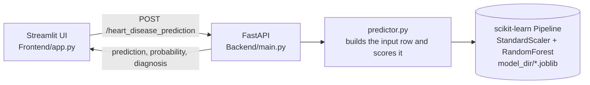

<div align="center">

# ⚕️ MedBuddy.ML

**Heart disease risk prediction with machine learning — a trained model, a REST API and a web UI in one repo.**


</div>

> [!WARNING]
> MedBuddy.ML is a learning / portfolio project. It is **not a medical device** and must not be used to diagnose, treat or make decisions about anyone's health. Always consult a qualified healthcare professional.

---

## Table of contents

- [Overview](#overview)
- [How it works](#how-it-works)
- [Project structure](#project-structure)
- [Dataset](#dataset)
- [Model and results](#model-and-results)
- [Getting started](#getting-started)
- [API reference](#api-reference)
- [Configuration](#configuration)
- [Retraining the model](#retraining-the-model)
- [Running on a server](#running-on-a-server)
- [Limitations](#limitations)
- [Possible next steps](#possible-next-steps)
- [Author](#author)

---

## Overview

MedBuddy.ML takes 13 routine clinical measurements (age, blood pressure, cholesterol, ECG results, and so on) and estimates the probability that a patient has heart disease.

- **Model** – a `StandardScaler` + `RandomForestClassifier` scikit-learn pipeline, tuned with randomized search and grouped cross-validation.
- **API** – a FastAPI service that validates input and returns a prediction, a probability and a plain-language diagnosis.
- **UI** – a Streamlit app where you enter patient details and get a result with one click.
- **Notebook** – the full workflow: EDA, baseline, model comparison, hyperparameter tuning and evaluation.

## How it works



The model is loaded from disk once when the API starts, so each request only pays for the prediction itself. Every prediction is also written to `logs/app.log`.

## Project structure

```text
Med-Buddy-ML/
├── Backend/
│   ├── main.py            # FastAPI app: /health and /heart_disease_prediction
│   ├── predictor.py       # Loads the trained pipeline once and scores requests
│   └── training.py        # Training script – evaluates and saves the model
├── Frontend/
│   └── app.py             # Streamlit user interface
├── Dataset/
│   └── heart.csv          # 1,025 rows x 14 columns
├── model_dir/
│   └── heart_disease_prediction_model.joblib   # Trained pipeline
├── notenook_files/
│   └── med_buddy_ml.ipynb # EDA, model selection and tuning
├── env_template.txt       # Template for your local .env file
├── requirements.txt       # Pinned Python dependencies
└── README.md
```

## Dataset

`Dataset/heart.csv` holds **1,025 patient records** with **13 clinical features** and a binary target. There are no missing values, and the classes are balanced (526 with heart disease, 499 without).

| Feature | Description |
| --- | --- |
| `age` | Age in years |
| `sex` | `1` = male, `0` = female |
| `cp` | Chest pain type (`0`–`3`) |
| `trestbps` | Resting blood pressure (mm Hg) |
| `chol` | Serum cholesterol (mg/dl) |
| `fbs` | Fasting blood sugar > 120 mg/dl (`1` = true) |
| `restecg` | Resting ECG result (`0`–`2`) |
| `thalach` | Maximum heart rate achieved |
| `exang` | Exercise-induced angina (`1` = yes) |
| `oldpeak` | ST depression induced by exercise relative to rest |
| `slope` | Slope of the peak exercise ST segment (`0`–`2`) |
| `ca` | Number of major vessels colored by fluoroscopy (`0`–`4`) |
| `thal` | Thalassemia test result (`0`–`3`) |
| `target` | **Label** – `1` = heart disease, `0` = no heart disease |

> **Duplicate rows.** 723 of the 1,025 rows are exact duplicates of another row. They were kept (they plausibly represent different patients with identical measurements), but every split in this project is *grouped by row*, so identical rows never end up on both sides of a train/validation or train/test boundary. This avoids inflated scores from data leakage.

## Model and results

**Pipeline:** `StandardScaler` → `RandomForestClassifier`

**Model selection.** Four models were compared with 5-fold `StratifiedGroupKFold` cross-validation on the training set. Random Forest scored best on both recall and F1:

| Model | CV recall (mean) | CV F1 (mean) |
| --- | :---: | :---: |
| **Random Forest** | **0.878** | **0.836** |
| Logistic Regression | 0.858 | 0.820 |
| XGBoost | 0.846 | 0.804 |
| Support Vector Machine | 0.802 | 0.776 |

**Tuning.** `RandomizedSearchCV` (60 candidates x 5 folds, scored on macro F1) picked: `n_estimators=1119`, `max_depth=5`, `min_samples_leaf=11`, `min_samples_split=30`, `max_features="sqrt"`, `max_samples≈0.6`, `ccp_alpha≈0.0017`.

**Held-out test set** (156 rows, 15 % of the data, grouped split, `random_state=42`) – class `1` = heart disease:

| Accuracy | Precision | Recall | F1 |
| :---: | :---: | :---: | :---: |
| 81.4 % | 0.80 | 0.90 | 0.84 |

Recall is the metric to watch for a screening-style task: the model catches about 9 in 10 patients who actually have heart disease. Training accuracy is 90.1 %, so there is some overfitting – see [Limitations](#limitations).

## Getting started

### Prerequisites

- Python 3.12 or newer (developed on 3.14) – required by the pinned NumPy version
- Git

### 1. Clone and install

```bash
git clone https://github.com/bharathhottin/Med-Buddy-ML.git
cd Med-Buddy-ML

python -m venv .venv
source .venv/bin/activate        # Windows: .venv\Scripts\activate

pip install -r requirements.txt
```

### 2. Create your `.env` file

```bash
cp env_template.txt .env         # Windows: copy env_template.txt .env
```

Open `.env` and set:

- `PROJECT_ROOT` to the **absolute path** of the cloned folder, e.g. `PROJECT_ROOT='/home/you/Med-Buddy-ML'` (on Windows: `PROJECT_ROOT='C:/Users/you/Med-Buddy-ML'`).
- `DATASET_DIR=Dataset` – the folder is capitalised in this repo, and on Linux/macOS paths are case-sensitive.

All other values can stay as they are. See [Configuration](#configuration) for the full list.

### 3. Start the API

The trained model is already included in the repo, so you can skip straight to serving it:

```bash
uvicorn Backend.main:app --reload --port 8000
```

Interactive API docs are now at <http://127.0.0.1:8000/docs>.

### 4. Start the web app

In a second terminal (with the virtual environment activated):

```bash
streamlit run Frontend/app.py
```

Open <http://localhost:8501>, enter the patient details and click **Predict**. The backend must be running first.

## API reference

| Method | Endpoint | Description |
| --- | --- | --- |
| `GET` | `/health` | Liveness check – returns `{"status": "ok"}` |
| `POST` | `/heart_disease_prediction` | Returns the model's prediction for one patient |

**Request**

```bash
curl -X POST http://127.0.0.1:8000/heart_disease_prediction \
  -H "Content-Type: application/json" \
  -d '{
        "age": 52, "sex": 1, "cp": 0, "trestbps": 125, "chol": 212,
        "fbs": 0, "restecg": 1, "thalach": 168, "exang": 0,
        "oldpeak": 1.0, "slope": 2, "ca": 0, "thal": 2
      }'
```

**Response**

```json
{
  "prediction": 1,
  "probability": 0.736,
  "diagnosis": "Heart Disease Detected"
}
```

| Field | Meaning |
| --- | --- |
| `prediction` | `1` = heart disease, `0` = no heart disease |
| `probability` | Model's probability of heart disease, rounded to 3 decimals |
| `diagnosis` | `"Heart Disease Detected"` or `"No Disease Detected"` |

All 13 features are required. `age`, `sex`, `cp`, `fbs`, `restecg`, `exang`, `slope`, `ca` and `thal` are integers; `trestbps`, `chol`, `thalach` and `oldpeak` are numbers. A missing or wrongly typed field returns HTTP `422`.

## Configuration

Settings are read from `.env` (never committed – it is listed in `.gitignore`).

| Variable | Used by | Description |
| --- | --- | --- |
| `PROJECT_ROOT` | API, training | Absolute path to the project folder |
| `DATASET_DIR` | training | Dataset folder, relative to `PROJECT_ROOT` (`Dataset`) |
| `DATASET_NAME` | training | Dataset file name (`heart.csv`) |
| `MODEL_DIR` | API, training | Where the model is saved / loaded (`model_dir`) |
| `MODEL_NAME` | API, training | Model file name (`heart_disease_prediction_model.joblib`) |
| `LOG_DIR` / `LOG_NAME` | API, training | Log folder and file (`logs` / `app.log`) |
| `TARGET_COL` | training | Name of the label column (`target`) |
| `TEST_SIZE` | training | Share of data held out for testing (`0.15`) |
| `RANDOM_STATE` | training | Seed for reproducible splits (`42`) |
| `API_URL` | web app | Full URL of the prediction endpoint (`http://127.0.0.1:8000/heart_disease_prediction`) |

## Retraining the model

From the project root, with your `.env` in place:

```bash
python Backend/training.py
```

The script loads the dataset, makes a grouped train/test split, fits the tuned pipeline, logs accuracy / recall / F1 with full classification reports for both sets, and saves the result to `model_dir/`. Restart the API afterwards so it picks up the new model.

To explore the full workflow (EDA, model comparison, tuning), open `notenook_files/med_buddy_ml.ipynb` in Jupyter. The notebook's `CSV_PATH` is set to a path on the author's machine, so point it at `Dataset/heart.csv` before running.

## Running on a server

To keep both services running in the background on a Linux host:

```bash
nohup uvicorn Backend.main:app --host 0.0.0.0 --port 8000 > uvicorn.log 2>&1 &
nohup streamlit run Frontend/app.py --server.address 0.0.0.0 --server.port 8501 > streamlit.log 2>&1 &
```

Set `API_URL` in `.env` to the address where the API is reachable from the Streamlit process.

## Limitations

- **Not clinically validated.** The model was trained on a single small dataset and has never been tested on new, real-world patients.
- **Small test set.** 156 held-out rows means the metrics above carry a wide margin of error.
- **Some overfitting.** Training accuracy (≈ 90 %) is higher than test accuracy (≈ 81 %).
- **Strict input contract.** The API checks field types but not clinical ranges; the web app limits ranges in the form.

## Possible next steps

- Add range validation to the API schema (Pydantic `Field` constraints)
- Explain predictions with feature importance or SHAP values
- Add unit tests for the API and CI via GitHub Actions
- Containerise the API and UI with Docker

## Author

**Bharath Hottin** – [@bharathhottin](https://github.com/bharathhottin)

If you find this project useful, a ⭐ on the repo is appreciated.
